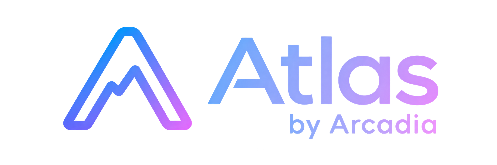
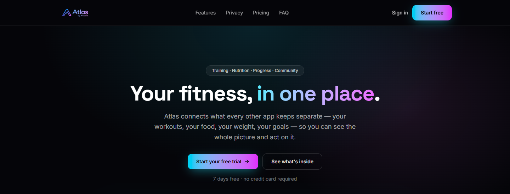
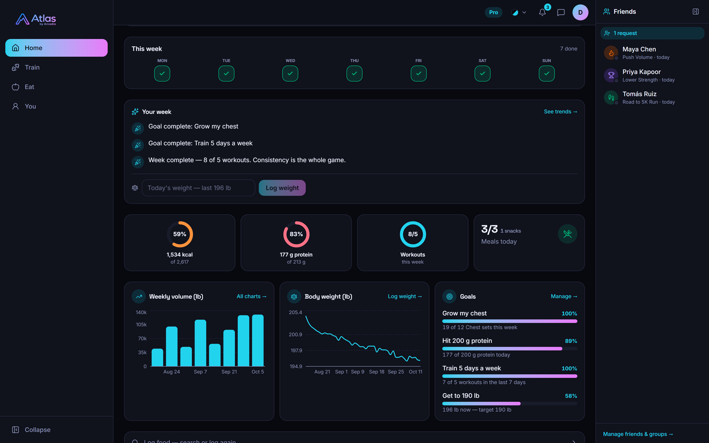
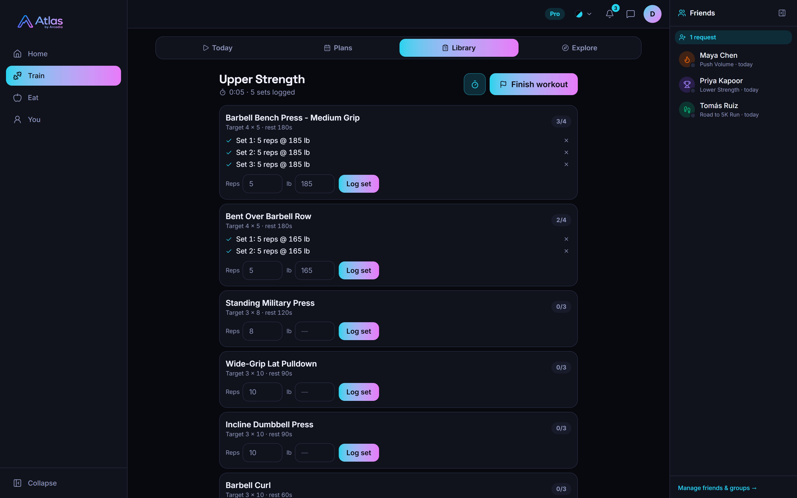
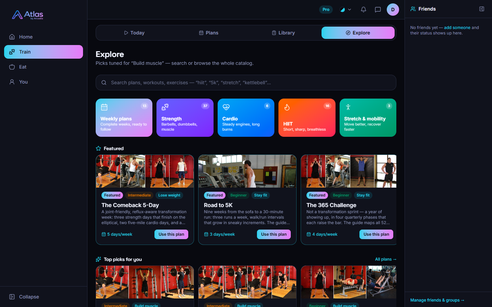
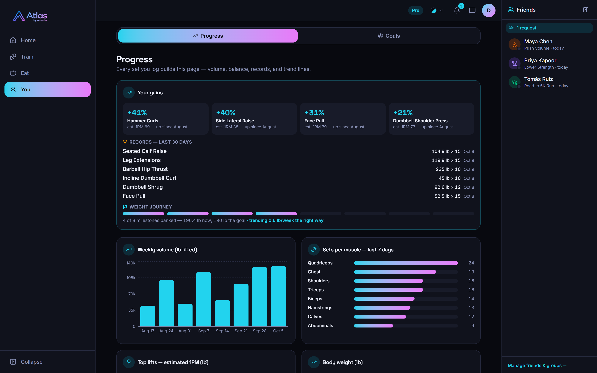
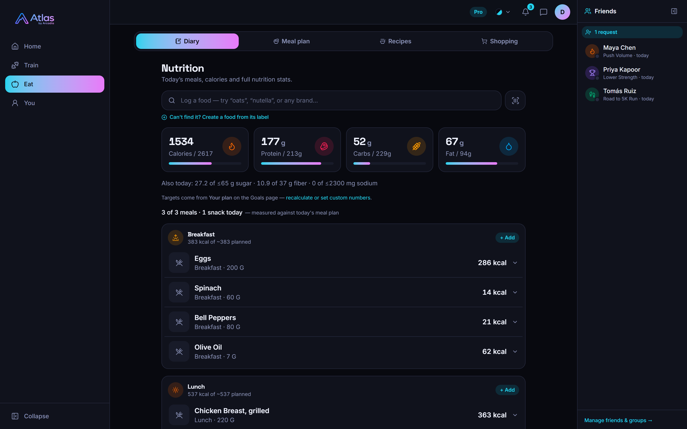
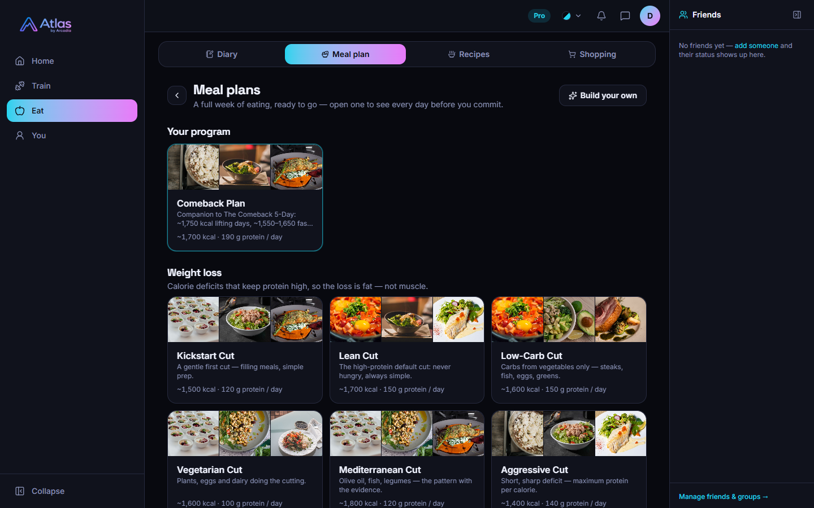
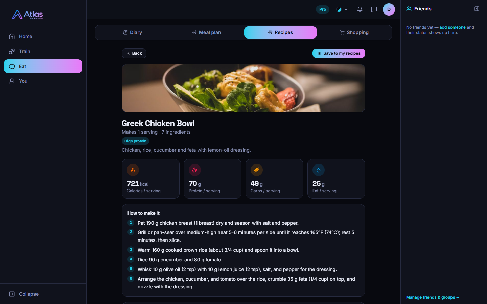
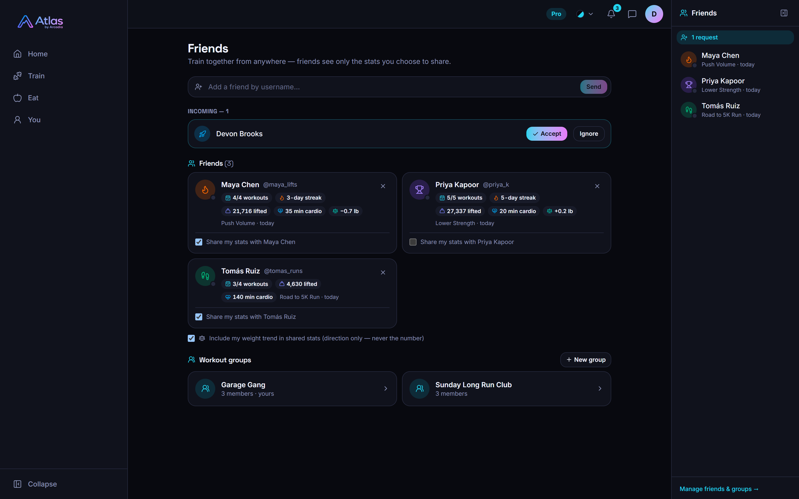

# Atlas

**Your fitness, in one place.**

Workouts, food, weight and goals, finally talking to each other.

[**Start your free trial at atlas-fitness.org →**](https://atlas-fitness.org)

7 days free · then $10/month or $72/year

## Why Atlas

Most people juggle a workout tracker, a calorie counter, a recipe app and a notes file
full of goals. None of them know about each other, so none of them can tell you what's
actually working.

Atlas puts it all in one place. Your training shapes your suggestions, your meal plan
builds your shopping list, every set you log feeds your progress charts, and your goals
keep score across all of it.

## Your day, at a glance

Open the app and your workout is right at the top: pick up where you left off, start
today's planned session, or just start lifting. Below it are your week, your calories and
protein, your weight trend and your goals. Drag the cards into whatever order suits you.

## Workout

- **Train your way.** Follow a weekly plan, start a saved routine, or start an empty
  workout and add exercises as you go.
- **Log sets in seconds** with your targets, rest times and last weights right there.
- **Adjust on the day.** Swap or skip an exercise without touching your routine, then
  save the session as a new routine when you finish, or update the old one.
- **Forgot to log?** Backdate a past workout in a few taps.
- **A full catalog to explore.** Weekly programs plus strength, cardio, HIIT and mobility
  workouts, from a gentle comeback week to a nine-week couch-to-5K, and hundreds of
  exercises with photos and how-to steps.

## History and progress

Every finished workout is saved with its duration, sets and volume. Open one to repeat
it, edit it or share it. Your progress page turns all of that into strength gains,
personal records, weekly volume, muscle balance and a body-weight trend.

## Eat

- **A calorie diary that's fast.** Search-as-you-type across millions of foods, or scan a
  barcode with your camera.
- **Targets made for you.** Atlas works out daily calories and macros from your profile
  and goal, or you can set your own numbers.
- **Ready-made meal plans.** Pick a week built for cutting, maintaining or gaining, and
  preview every day before you commit.
- **Recipes with real photos and full macros.** Build your own, save favorites, or browse
  what the community is cooking.
- **One tap from plan to plate.** Log a planned day straight to your diary, or turn the
  week into a shopping list.

## Better with friends

Add friends and start workout groups. Share finished workouts to your feed and profile,
see what your friends are training, and swap plans and recipes with reviews and ratings. You choose exactly which
stats each friend can see. Your weight trend shows only its direction, never the number.

## Made for your phone

Atlas is designed mobile-first, with a bottom tab bar for Home, Workout, History, Eat and
You. It works just as well in the gym or the kitchen as it does on your desktop.

## Your data stays yours

Your workouts, meals and measurements are stored on your own device first and synced
securely so they follow you everywhere. We don't sell your data and we don't mine it.
You can delete your account, and everything in it, at any time.

## Pricing

|                |                                     |
| -------------- | ----------------------------------- |
| **Free trial** | 7 days, every feature               |
| **Monthly**    | $10/month, cancel anytime           |
| **Yearly**     | $72/year, the equivalent of $6/month |

Checkout is handled securely by Stripe.

## Built with

Atlas is a modern TypeScript app from front to back:

- **React 19**, **Vite** and **Tailwind CSS** for a fast, responsive interface
- **Capacitor** to bring the same app to Android
- **SQLite** on the device for instant, offline-friendly data
- **Hono** on **Node.js** with **PostgreSQL** in the cloud
- **Stripe** for payments
- Hosted on **Railway** behind **Cloudflare**

## Credits

- Exercise data and images: [Free Exercise DB](https://github.com/yuhonas/free-exercise-db)
- Food data: [FatSecret Platform](https://platform.fatsecret.com),
  [USDA FoodData Central](https://fdc.nal.usda.gov) and
  [Open Food Facts](https://world.openfoodfacts.org)

---

© Arcadia. All rights reserved. Atlas is proprietary software; this code is not licensed
for use, copying or distribution.

